<p align="center">
  
</p>

<h1 align="center">Penguin</h1>

<p align="center">
  <b>A fast, private, keyboard-first email client for the Mac.</b><br>
  Your mail lives on your Mac, so search, triage and AI never wait on the network.
</p>

<p align="center">
  
  
  
  
  <a href="LICENSE"></a>
  
</p>

<p align="center">
  <a href="https://github.com/justingluska/penguin/releases/latest/download/Penguin.dmg"><b>Download for Mac</b></a> ·
  <a href="docs/FEATURES.md">Features</a> ·
  <a href="docs/DEVELOPMENT.md">Build from source</a> ·
  <a href="docs/PERFORMANCE.md">Performance</a> ·
  <a href="docs/PRIVACY.md">Privacy</a> ·
  <a href="#docs">Docs</a>
</p>

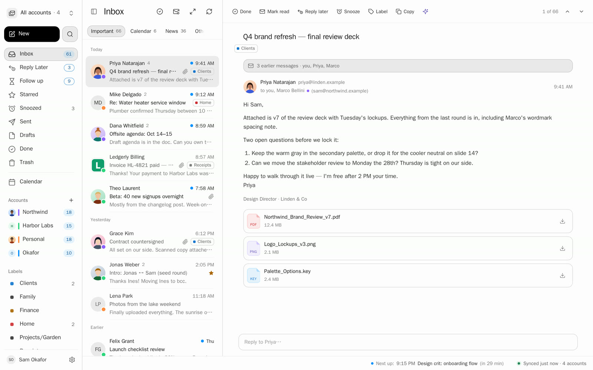

Gmail and Google Workspace come first; Outlook.com, Microsoft 365, iCloud, Yahoo, Fastmail and any IMAP server work too. There are no Penguin servers: the app talks to your mail provider directly.

> **Beta.** [Download Penguin for Mac](https://github.com/justingluska/penguin/releases/latest/download/Penguin.dmg) (Apple silicon). Gmail needs your own Google OAuth client: about ten minutes, [step by step](docs/google-setup.md).

## Why Penguin

- ⚡ **Fast.** Every key press is answered from a local database. Searching 300,000 messages takes a few milliseconds.
- 🔍 **Search that finds it.** Gmail's operators, typo tolerance, plain-English dates, and search by meaning.
- 💬 **Ask your inbox.** "When is my flight to Lisbon?" Exact answers from your mail, with the emails they came from.
- 🧠 **Smart, on your Mac.** Summaries, Write with AI and search by meaning run on local models. No API key, nothing sent anywhere.
- 🔒 **Private by default.** Tracking pixels removed, remote images held, hostile email HTML sanitized and sandboxed.
- ⌨️ **Keyboard-first.** Gmail-style keys, a ⌘K palette with every command, and a coach that teaches you the keys.
- 🤖 **Works with your agents.** Chat about your mail with the Claude Code or Codex you already use, or give any agent an MCP server and CLI, with a permission level you pick.
- 🧩 **Extensions.** Add your own buttons to every email: make a task, file it in a CRM, save it to notes. A folder with a manifest and a script.

## Search that finds it

Press `/` and type. Results update on every keystroke across all your accounts, with facets, matching attachments and the people behind them. It forgives typos, word forms and accents, and a local embedding model finds mail that says the same thing in other words: "plane tickets to portugal" finds the Lisbon boarding passes.

<p>
  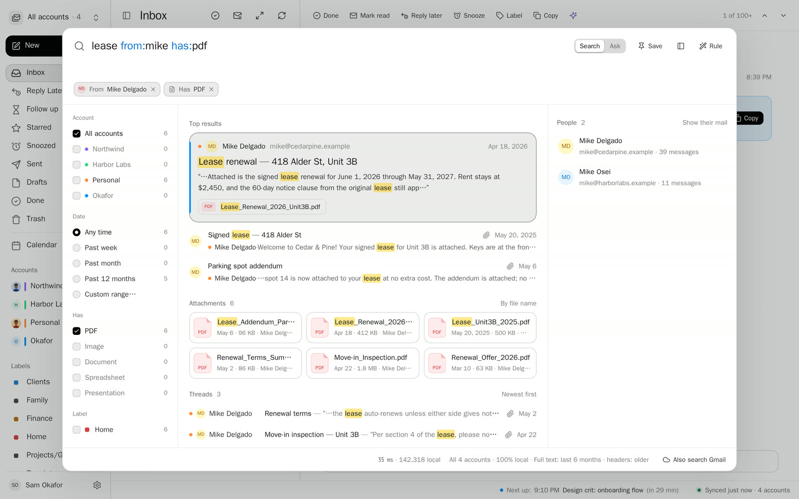
  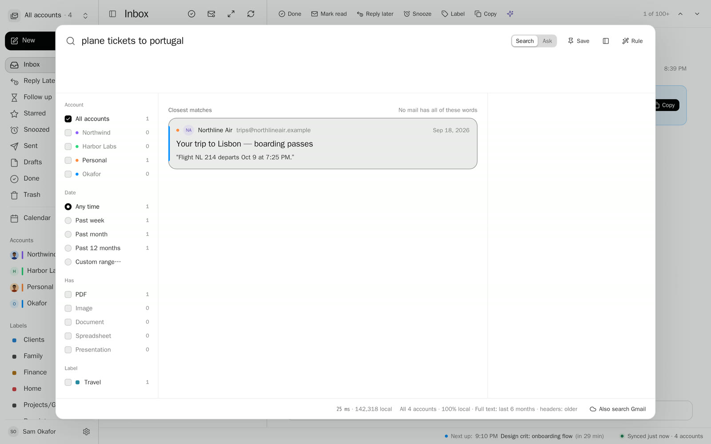
</p>

Scored on 570 judged queries, keyword plus meaning reaches an nDCG@10 of 0.951. → [Search in depth](docs/FEATURES.md#search) · [operators](docs/SEARCH.md) · [how it's measured](docs/SEARCH-EVAL.md)

## Ask your inbox

Type a question into search. Penguin computes the answer from your mail (flights, stays, receipts, parcels, bills, people) and shows the emails it came from. Counts and totals read every matching email, never a sample, and no language model writes the answer.

<p>
  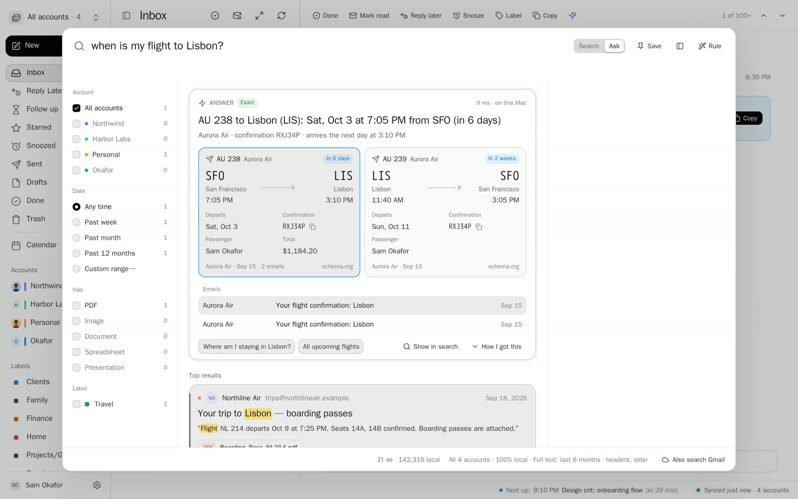
  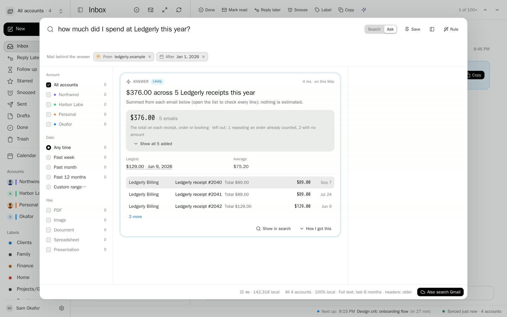
</p>

→ [How Ask works](docs/ASK.md)

## Smart, with AI that stays on your Mac

Thread summaries (with anything asked of you and its deadline), Write with AI and suggested replies run on Apple's on-device model. Search by meaning uses a small embedding model that runs locally. No API key, no server, and nothing runs until you ask.

<p>
  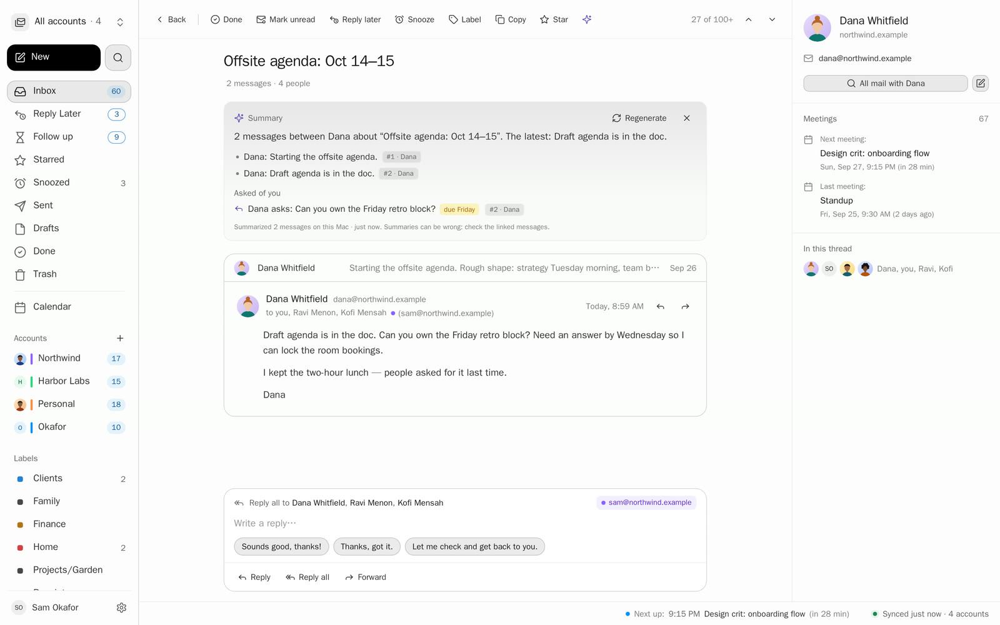
  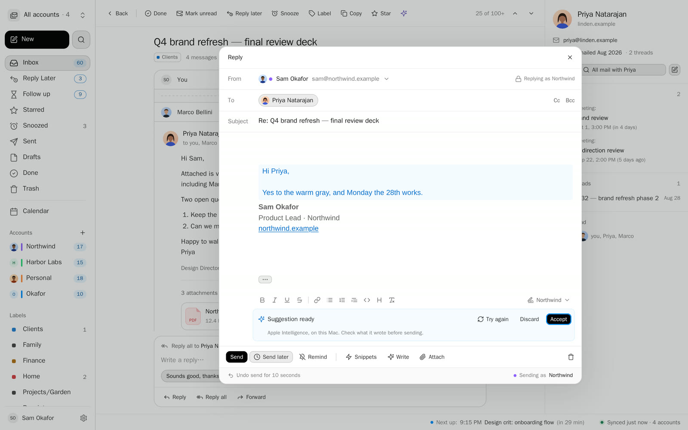
</p>

→ [On-device AI](docs/FEATURES.md#on-device-ai) · [summaries](docs/SUMMARIES.md) · [search by meaning](docs/SEMANTIC.md)

## Fast

<!-- perf:start -->
| Search 300,000 messages | Search as you type | Open a conversation | Answer a question |
|:---:|:---:|:---:|:---:|
| **5.6 ms** | **5.0 ms** a keystroke | **0.32 ms** | **8.2 ms** |

Medians on a synthetic 300,000-message mailbox on an Apple M5 Pro (macOS 26.6.2, 18 cores, 64 GiB RAM), release build, commit 9d41ddcd5c7c. How it's measured, every number and why it's fast: [docs/PERFORMANCE.md](docs/PERFORMANCE.md).
<!-- perf:end -->

Archive, label, star and snooze change the screen in the same frame as the key; the server catches up behind it.

## Built for inbox zero

Split Inbox, Get to zero, Reply Later, snooze, follow-up reminders, snippets, instant replies, send later and undo send.

<p>
  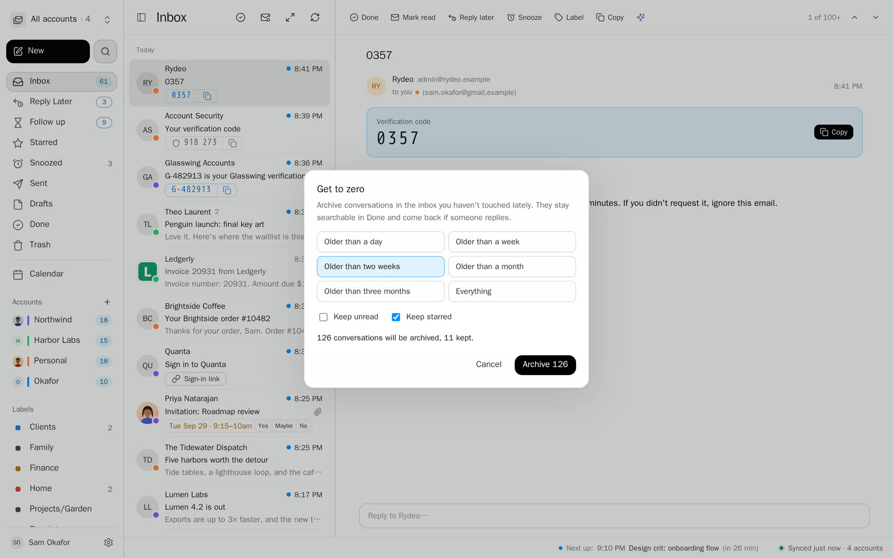
  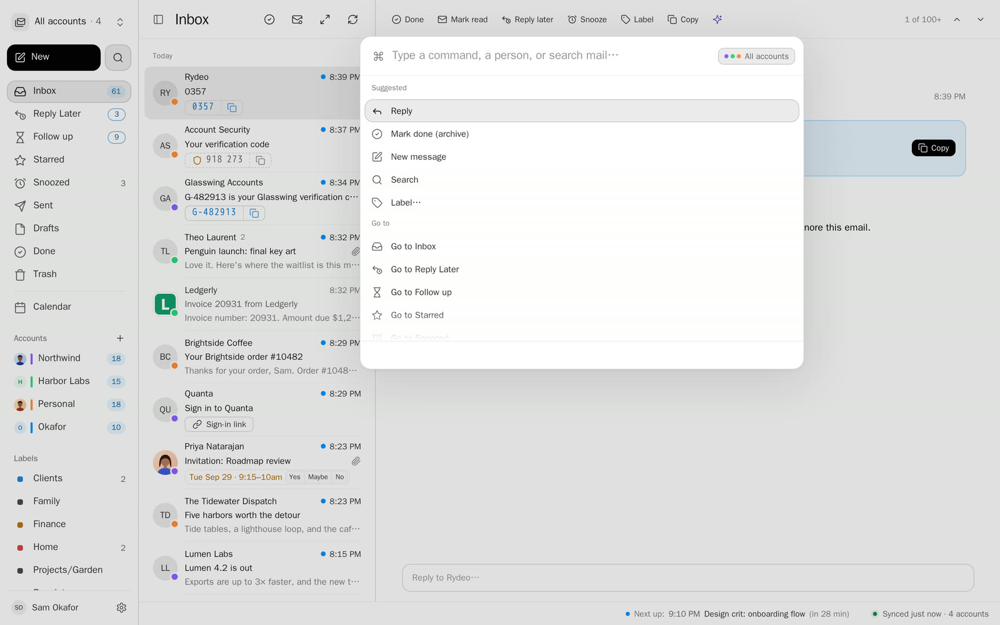
</p>

Plus smart views for receipts, travel, packages and bills, calendar invites you can answer in the thread, rules and automations, profiles, verification codes you copy from the list, and Stats: your year in email, counted on your Mac. → [Every feature](docs/FEATURES.md)

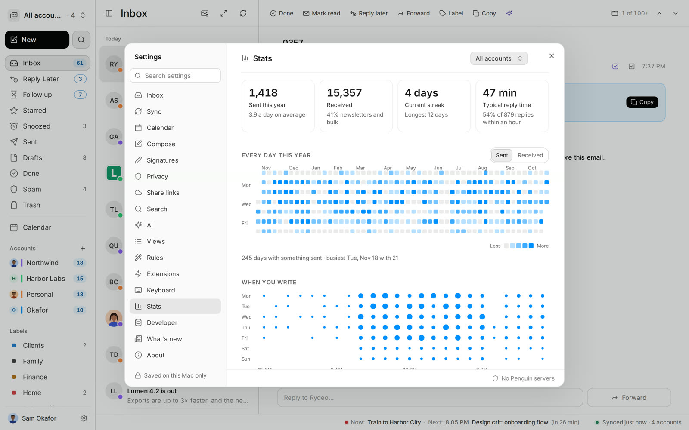

## Works with your agents

**Chat beside your mail.** Press ⌘⇧I and ask the Claude Code or Codex you already use about the open conversation: "what does Theo need from me?", "draft a reply for me to review". Penguin has no model or API key of its own for this. It runs your CLI, signed in with your account, with Penguin's MCP server as its only tools, and shows a chip for each tool it used. Off until you turn it on. → [Agent chat](docs/AGENT-CHAT.md)

**MCP server and `penguin-cli`.** Any agent or script can search and read the local index (`penguin-cli search "from:priya has:pdf" --json`), and, if you allow it, organize mail and write drafts. You pick the level in Settings → Developer: off (the default), read only, read + organize + draft, or send. Organizing is undoable, an agent only ever touches its own drafts, every send waits in the outbox first, mail content reaches the agent marked as untrusted, and every call is written to an audit log. → [CLI and MCP](docs/CLI.md)

## Extensions

An extension adds your own buttons to every email: "Create task", "Save to notes", "Send to my CRM". It's a folder with an `extension.json` and a program; Penguin passes the email (and, if the action asks, the whole conversation) as JSON on stdin and shows the program's answer as a toast with an Open link. An action can ask a few questions first in a form, and a program can ask you to confirm before it acts.

<p>
  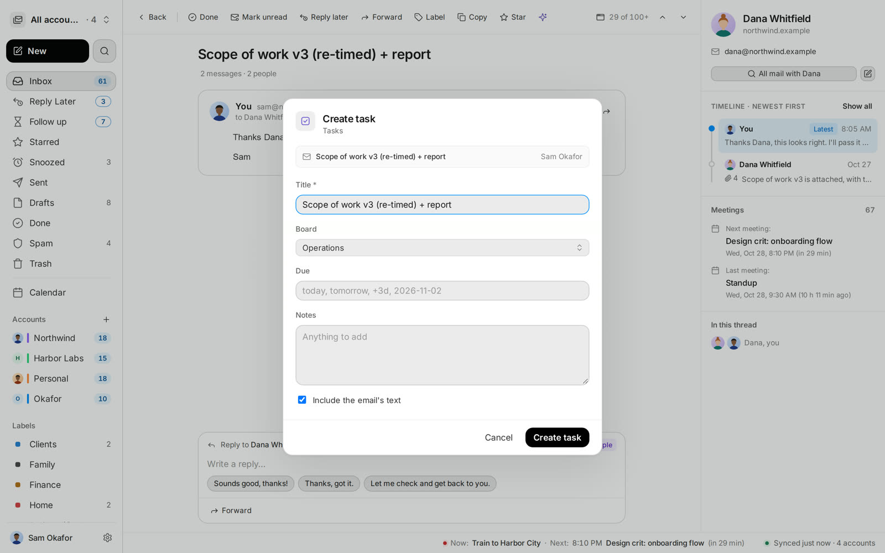
  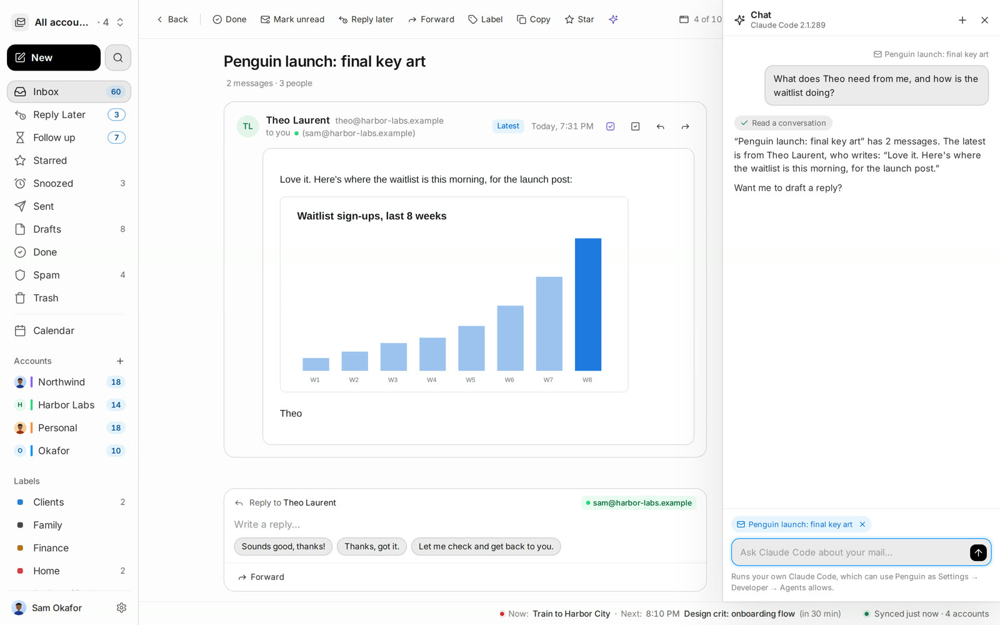
</p>

1. Settings → Extensions → **Open extensions folder**, and drop the extension's folder in (a symlink to a git checkout works).
2. Turn on **Allow**. Settings shows exactly which command each button runs and what it receives.
3. The buttons appear in each message's header, its right-click menu and ⌘K.

Nothing runs until you allow it, and approval covers the folder exactly as it was: any edit to its files turns it off until you allow it again. A complete two-file example, the payload, forms, confirmations, and how to have an agent build one for you: [docs/EXTENSIONS.md](docs/EXTENSIONS.md).

## Private by design

- Your mail, search index and AI stay on your Mac. Tokens and passwords live in the macOS Keychain.
- Tracking pixels are blocked, remote images wait until you ask, and link tracking can be stripped.
- Email HTML is sanitized in Rust and shown in a sandboxed frame with no scripts.

→ [Privacy](docs/PRIVACY.md) · [Security and reporting a vulnerability](docs/SECURITY.md)

## How it works

- **A local copy of your mailbox.** Penguin syncs your mail into a SQLite database on your Mac, as Apple Mail, Thunderbird and Outlook keep theirs: the last 6 months in full and older mail as headers (Settings → Sync changes both), with a body fetched when you open it. It keeps it current with each provider's change feed (Gmail's history API, IMAP IDLE, Microsoft Graph delta). Every screen reads from that database, so nothing you do waits on the network; archiving and labeling change the screen first and reach the server behind it.
- **Search** is SQLite FTS5 with Penguin's own query parser and ranking, plus a small local embedding model for search by meaning, judged on 570 queries ([SEARCH-EVAL.md](docs/SEARCH-EVAL.md)).
- **No Penguin servers.** The app talks straight to Google, Microsoft or your IMAP server with credentials you own, kept in the macOS Keychain. Updates come from a signed feed.
- **Rust core, native shell.** The store, sync, search, MIME and HTML sanitizer are Rust crates; the window is Tauri 2 with a React UI; on-device AI goes through Apple's Foundation Models from a small Swift bridge.

→ [Architecture](docs/ARCHITECTURE.md) · [Performance](docs/PERFORMANCE.md)

## Getting started

1. **[Download Penguin.dmg](https://github.com/justingluska/penguin/releases/latest/download/Penguin.dmg)**, open it and drag Penguin to Applications. It's signed and notarized by Apple, and it keeps itself up to date.
2. **Add your accounts.** Gmail and Google Workspace use your own Google OAuth client, so no shared client and no Penguin server ever sees your tokens: about ten minutes, [step by step](docs/google-setup.md). Outlook uses your own Microsoft app registration, and iCloud, Yahoo, Fastmail and other IMAP servers use an app password ([details](docs/providers-and-onboarding.md)).

Needs a Mac with Apple silicon. Summaries and Write with AI need macOS 26 with Apple Intelligence; everything else works without them.

**Build from source** or try the UI on a fictional mailbox with no account:

```sh
git clone https://github.com/justingluska/penguin.git && cd penguin/apps/desktop
npm ci && npm run dev:mock      # http://localhost:1420
npm run tauri build -- --bundles app
```

Requirements and details: [docs/DEVELOPMENT.md](docs/DEVELOPMENT.md).

## Docs

| | |
|---|---|
| [Features](docs/FEATURES.md) | The full tour, how Penguin compares, known limitations |
| [Development](docs/DEVELOPMENT.md) | Build, connect accounts, architecture, contributing, releases |
| [Search](docs/SEARCH.md) · [Ask](docs/ASK.md) | The query language and how questions are answered |
| [Performance](docs/PERFORMANCE.md) | Every benchmark and why it's fast |
| [Privacy](docs/PRIVACY.md) · [Security](docs/SECURITY.md) | Tracking protection, threat model, reporting a vulnerability |
| [CLI and MCP](docs/CLI.md) · [Agent chat](docs/AGENT-CHAT.md) | `penguin-cli`, the MCP server and its permission levels, and chatting with Claude Code or Codex |
| [Extensions](docs/EXTENSIONS.md) | Add your own buttons to emails: the manifest, what the program gets, building one with an agent |

## License

Source-available under the [PolyForm Shield License 1.0.0](LICENSE): use it, change it and send improvements back, but don't sell it or ship it as a competing email app. The name "Penguin" and its icon aren't covered by the license. Full terms and contribution notes: [docs/DEVELOPMENT.md](docs/DEVELOPMENT.md#license).
